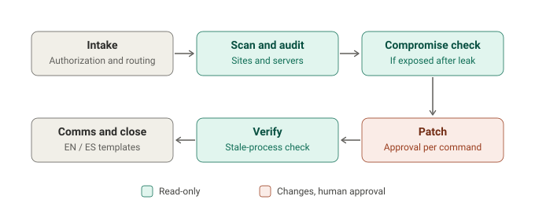

# php-vuln-responder

Scan, patch, verify and check for compromise after critical PHP vulnerabilities,
with AI agents doing the legwork and a human approving every change.

Ships ready for **PHP2Shell** (CVE-2026-109618 / CVE-2026-109619): fixed in
PHP **8.5.12, 8.4.27, 8.3.36, 8.2.35**. PHP 8.1 and older get no fix.



## What's inside

| | |
|---|---|
| **Skills** | `pvr-navigator` (start here), `pvr-fleet-scan`, `pvr-server-audit`, `pvr-patch`, `pvr-compromise-check`, `pvr-verify-close`, `pvr-client-comms` (EN/ES), `pvr-advisory-update` |
| **Scripts** | `scan.sh`, `detect-stack.sh`, `patch-plan.sh`, `ioc-hunt.sh`, `verify.sh`. Read-only, bash + curl only |
| **Claude Code** | `/pvr` commands, `pvr-verifier` agent, safety hook |
| **Advisory** | `advisories/php2shell.env`. One file drives everything; new CVE = new file |

## Install

```bash
# Claude Code (full plugin)
/plugin marketplace add luivc1/php-vuln-responder
/plugin install php-vuln-responder@php-vuln-responder

# Hermes, or any Agent Skills folder
./install.sh --target hermes
./install.sh --dest /path/to/skills
```

Other agents: point them at [`AGENTS.md`](AGENTS.md).

## Quick start (no agent)

```bash
S=~/.php-vuln-responder/scripts
bash $S/scan.sh -f sites.txt -o reports/fleet   # color HTML + CSV report
bash $S/scan.sh --local                         # on a server
bash $S/patch-plan.sh                           # prints commands, runs nothing
sudo bash $S/ioc-hunt.sh                        # was it hacked?
bash $S/verify.sh --url https://example.com     # did the patch take?
```

Or just ask your agent: *"Are my PHP sites affected by PHP2Shell?"* /
*"¿Mis sitios están vulnerables a PHP2Shell?"*

## Safety

- Scripts never change anything. Every change is shown and approved one command at a time.
- No exploit code, ever. Verification is by version and backport evidence.
- Evidence is copied before anything is removed.
- Only scan systems you own or are authorized to assess.

## License

[MIT](LICENSE) © 2026 Innovatask LLC
